# 校园快递代取平台（Campus Express）

[](https://github.com/xixigaoshou/campus-express/actions/workflows/ci.yml)
[](https://openjdk.org/projects/jdk/17/)
[](https://spring.io/projects/spring-boot)
[](https://vuejs.org/)
[](https://www.mysql.com/)
[](LICENSE)

一个前后端分离的校园快递代取平台。需求方发布代取需求并冻结报酬，接单者在大厅抢单、取件、送达，需求方确认收货后报酬自动结算给接单者。围绕这一主线，平台实现了完整的订单状态机、信誉分体系、超时自动处理、转单接力、钱包资金闭环与多层次安全校验。

- 后端：Java 17 + Spring Boot 3.2.5 + MyBatis-Plus + JWT + MySQL 8.0，端口 `8080`
- 前端：Vue 3 + Vite + Vue Router 4 + Pinia + Axios + Element Plus，端口 `5173`
- 数据库：MySQL 8.0，库名 `campus_express`

---

## 一、功能特性

| 模块 | 说明 |
| --- | --- |
| 用户与认证 | 注册（短信验证码校验手机号）、登录（JWT 无状态令牌）、找回密码（两步验证）、个人中心、头像上传、登录密码与支付密码分离 |
| 需求发布 | 发布者发布代取需求（取件码、快递公司、取件/送达地点、期望时间、报酬），发布即冻结报酬 |
| 需求大厅 | 接单者浏览待接单订单、按关键词与报酬范围筛选、乐观锁抢单 |
| 订单流转 | 严格状态机：待接单 → 已接单 → 取件中 → 配送中 → 待收货 → 已完成；每次变更写入状态历史 |
| 转单接力 | 接单者取件前可发起转单，订单进入接力专区由他人承接，30 分钟无人接力自动撤回 |
| 包裹凭证 | 接单者上传取件照 / 送达照，作为履约凭证 |
| 站内留言 | 订单参与者就订单沟通，WebSocket 实时推送未读信号 |
| 站内通知 | 状态变更、超时提醒、评价、接力等事件推送通知，实时刷新角标 |
| 评价体系 | 订单完成后双方互评，好评加分、差评扣分，评价结果联动信誉分与通知 |
| 信誉分体系 | 初始 100、上限 150，好评 +1 / 差评 −2 / 违约 −5，低于 80 禁止接单，流水全程可追溯 |
| 钱包 | 充值、提现、冻结、解冻、结算，形成完整资金闭环，资金操作需支付密码 |
| 超时自动处理 | 定时任务每 60 秒扫描：24h 无人接单提醒、超时未取件退回、取件后超时取消、送达后自动确认收货 |

---

## 二、界面预览

> 截图取自本地运行环境（前端 `5173` / 后端 `8080`），演示账号见第八节。

### 登录 / 注册


校园蓝 + 快递橙主题：左侧品牌区展示标语与特性点，右侧为毛玻璃登录卡片，支持登录 / 注册切换与找回密码。

### 发布者视角（`can_publish = true`）

| 我的订单 · 我的发布 | 发布代取需求 |
| --- | --- |
| 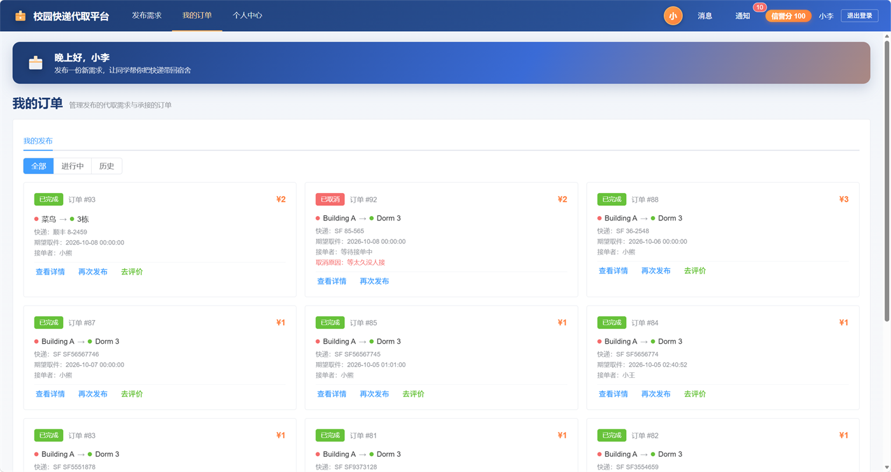 | 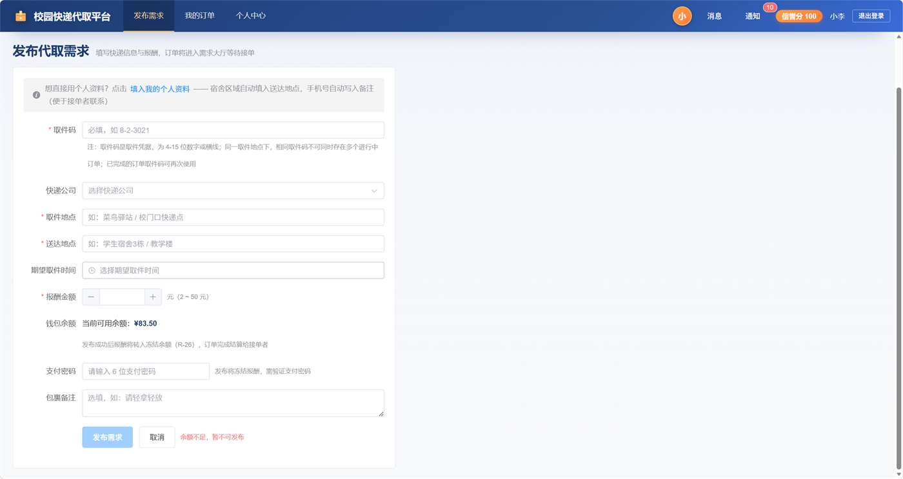 |

| 订单详情 · 状态变更轨迹 | 个人中心 · 统计与信誉规则 |
| --- | --- |
| 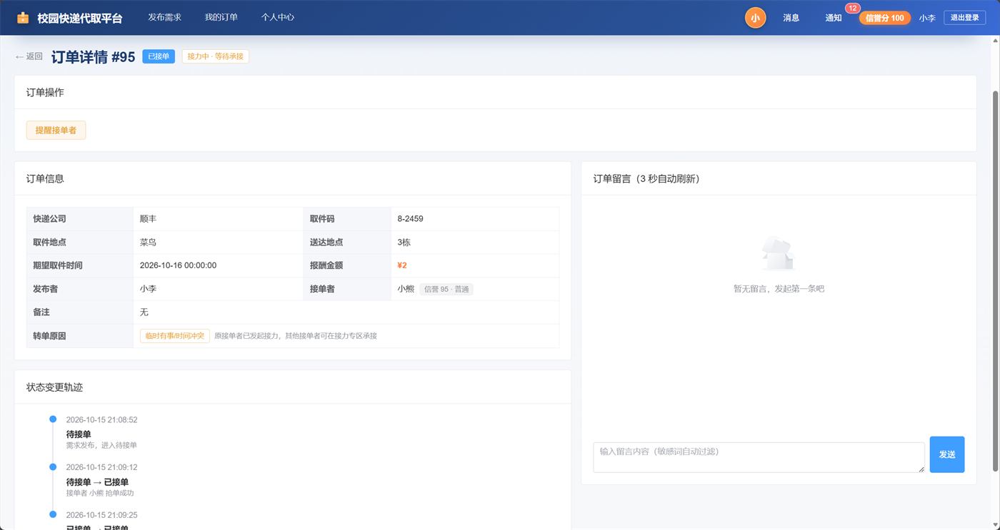 | 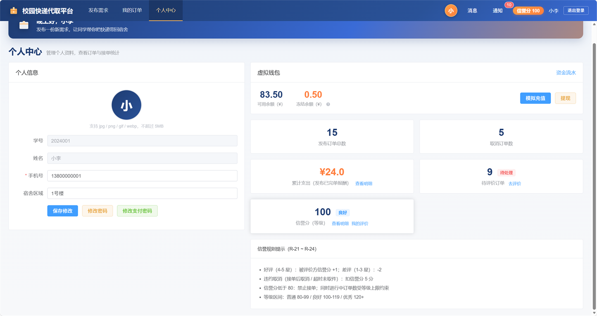 |

| 通知中心 | 消息会话 |
| --- | --- |
| 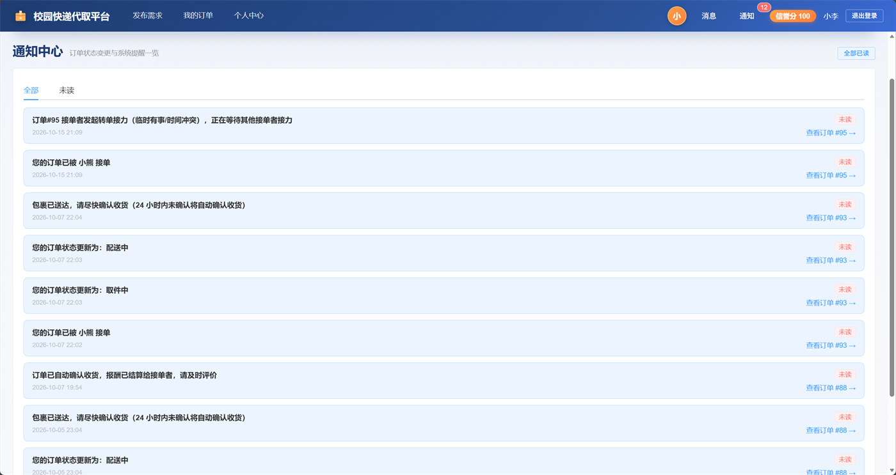 | 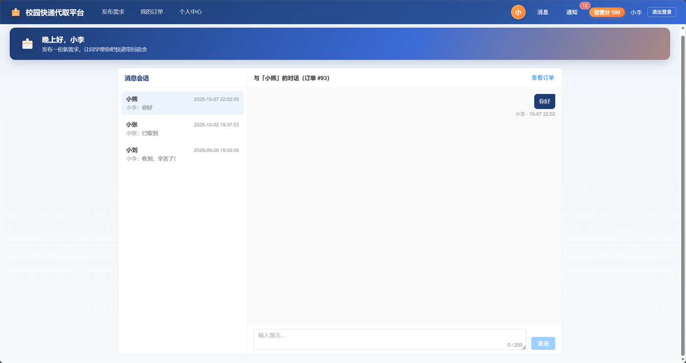 |

### 接单者视角（`can_publish = false`）

| 需求大厅 | 接力专区 |
| --- | --- |
| 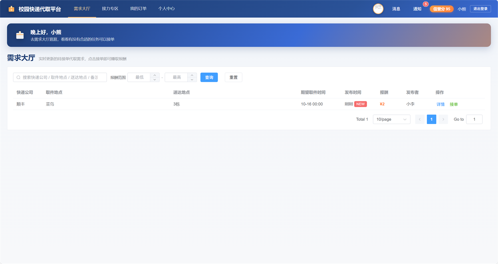 | 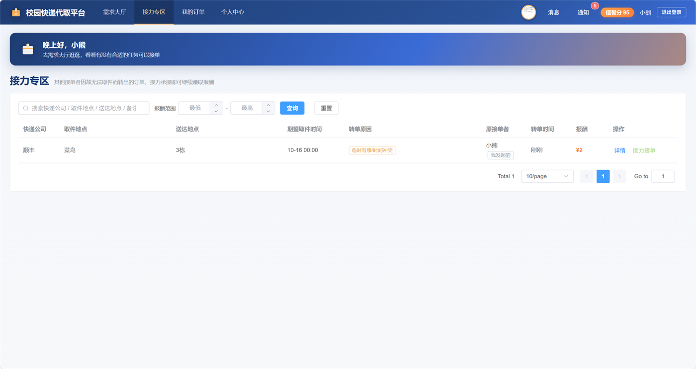 |

| 订单详情 · 取件 / 转单 / 留言 | 我的订单 · 我的接单 |
| --- | --- |
| 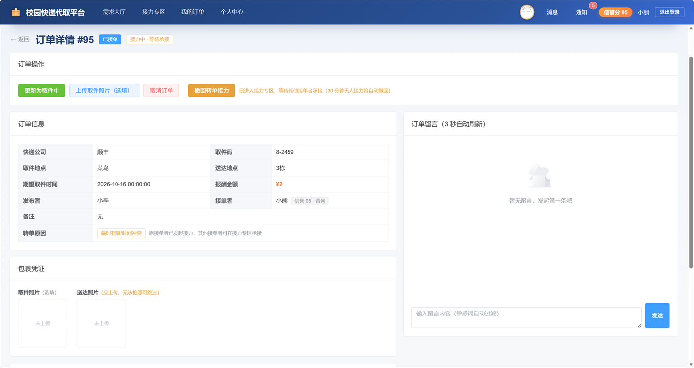 | 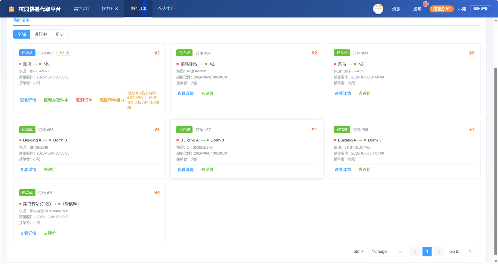 |

### 钱包资金流水

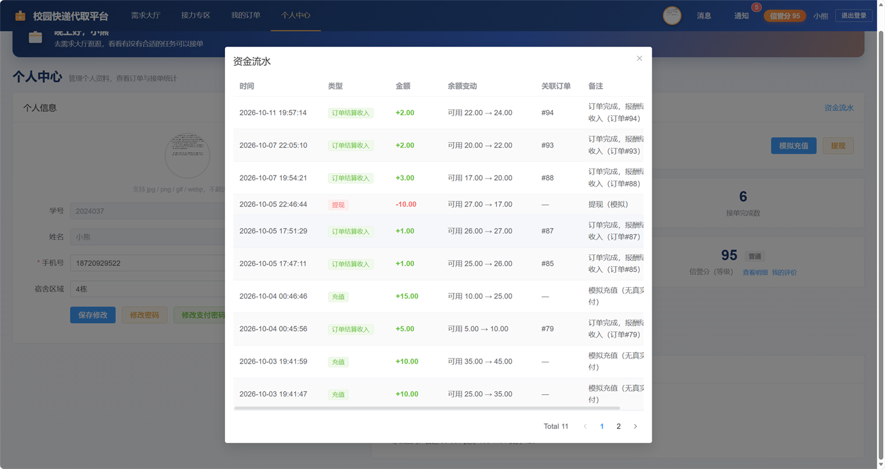

充值、提现、结算收入均按流水记录（含变化前 / 后余额与关联订单），资金闭环可追溯。

---

## 三、目录结构

```
6ab0ed45647a63983f854f91/
├── campus-express-backend/          # 后端 Spring Boot 工程
│   ├── src/main/java/com/campus/express/
│   │   ├── controller/              # UserController / OrderController / MessageController
│   │   │                            # EvaluationController / NotificationController / WalletController
│   │   ├── service/                 # 服务接口
│   │   │   └── impl/                # 服务实现
│   │   │       ├── OrderServiceImpl.java            # 订单服务门面（147 行，纯委派）
│   │   │       ├── OrderLifecycleServiceImpl.java   # 订单流转领域服务（697 行）
│   │   │       ├── OrderRelayServiceImpl.java       # 转单接力领域服务（277 行）
│   │   │       ├── OrderTimeoutServiceImpl.java     # 超时调度领域服务（281 行，@Scheduled）
│   │   │       └── OrderDomainSupport.java          # 三个领域服务共用的纯函数
│   │   ├── mapper/                  # MyBatis-Plus Mapper 接口
│   │   ├── entity/ dto/ vo/         # 实体、请求 DTO、响应 VO
│   │   ├── common/                  # Result、BusinessException、GlobalExceptionHandler
│   │   ├── config/                  # WebMvcConfig、WebSocketConfig、BusinessRulesConfig、
│   │   │                            # JwtInterceptor（令牌校验）、PasswordConfig、JacksonConfig、
│   │   │                            # OpenApiConfig（Knife4j 在线接口文档）
│   │   ├── ws/                      # WebSocket 会话管理与推送（未读信号实时刷新）
│   │   └── util/                    # JwtUtil、ImageUtil、PasswordUtil 等
│   ├── src/main/resources/
│   │   ├── application.yml          # 主配置（数据源、JWT、业务规则参数）
│   │   ├── application-prod.yml     # 生产环境覆盖配置
│   │   └── mapper/*.xml             # MyBatis SQL 映射
│   ├── src/test/java/.../           # 单元测试 + 集成测试 + 并发压测（29 个测试类 / 268 用例）
│   │   ├── service/impl/            # Service 层单元测试（Mockito）
│   │   └── integration/             # MockMvc 主链路集成测试、HTTP 级并发压测
│   ├── docs/
│   │   ├── architecture.md          # 架构设计与技术取舍
│   │   ├── load-test-report.md      # 压测报告（Markdown）
│   │   └── load-test-report.html    # 压测报告（可视化 HTML）
│   ├── Dockerfile                   # 后端镜像（多阶段：Maven 构建 → JRE 运行）
│   └── pom.xml
├── campus-express-frontend/         # 前端 Vue 3 工程
│   ├── src/
│   │   ├── views/                   # Home / LoginRegister / DemandHall / RelayHall
│   │   │                            # PublishOrder / MyOrder / OrderDetail / MessageCenter
│   │   │                            # NotificationCenter / PersonalCenter
│   │   ├── components/EmptyState.vue# 统一空状态组件
│   │   ├── router/                  # 路由与登录守卫
│   │   ├── stores/                  # Pinia（user 状态、token、角色）
│   │   ├── utils/                   # request（Axios 封装）、time、各类原因常量
│   │   └── assets/
│   ├── vite.config.js               # 开发代理 /api /uploads /ws → http://localhost:8080
│   ├── nginx.conf                   # 生产 Nginx 站点配置（托管 dist + 反向代理后端）
│   ├── Dockerfile                   # 前端镜像（多阶段：Node 构建 → Nginx 托管）
│   └── package.json
├── docker-compose.yml               # 一键启动 MySQL + 后端 + 前端
├── docker/mysql-init/               # MySQL 容器首次启动自动执行的建库建表脚本
├── .github/workflows/ci.yml         # CI：跑测试 + 覆盖率 + 前端构建 + 镜像构建校验
├── screenshots/                     # 界面预览截图（见「二、界面预览」）
├── project_init/
│   ├── sql/                         # 数据库脚本（schema.sql + 各增量脚本，UTF-8 无 BOM）
│   └── docs/                        # 项目概览、接口文档、测试用例、部署说明
└── README.md
```

---

## 四、环境要求

| 组件 | 版本要求 |
| --- | --- |
| JDK | 17 及以上 |
| Maven | 3.8+（IDEA 可内置） |
| MySQL | 8.0 |
| Node.js | 18 及以上 |
| 开发工具 | IntelliJ IDEA（后端）+ 任意编辑器（前端） |
| Docker（可选） | 24+ 与 Docker Compose v2，仅用一键部署时需要 |

---

## 五、快速开始

### 步骤 1：初始化数据库

1. 确认本机 MySQL 8.0 已启动。
2. 按**顺序**执行 `project_init/sql/` 下的脚本（全新安装推荐顺序见下表）。

**全新数据库推荐执行顺序**

| 顺序 | 脚本 | 作用 |
| --- | --- | --- |
| 1 | `schema.sql` | 建库 + 核心表（t_user / t_order / t_order_status_history / t_order_transfer / t_message / t_evaluation / t_wallet / t_wallet_log）+ 索引约束 + 演示数据 |
| 2 | `02_站内通知表.sql` | 站内通知表 `t_notification` |
| 3 | `06_信誉分明细表.sql` | 信誉分流水表 `t_credit_log` |
| 4 | `07_用户头像字段.sql` | `t_user.avatar` 头像字段 |
| 5 | `11_支付密码字段.sql` | `t_user.pay_password_hash` 支付密码字段 |

> 说明：`03_待收货状态升级.sql`、`04_角色发布权限.sql`、`08_转单接力.sql`、`09_取件码字段.sql`、`10_角色权限同步.sql`、`12_取件码并发唯一.sql` 的内容**已合并进 `schema.sql`**，全新安装无需单独执行；仅当从旧版本数据库升级时才需要按序号增量执行。

命令行执行示例：

```bash
mysql -uroot -p < project_init/sql/schema.sql
mysql -uroot -p < project_init/sql/02_站内通知表.sql
mysql -uroot -p < project_init/sql/06_信誉分明细表.sql
mysql -uroot -p < project_init/sql/07_用户头像字段.sql
mysql -uroot -p < project_init/sql/11_支付密码字段.sql
```

> 所有 SQL 脚本均为 UTF-8 **无 BOM**，可直接用命令行 `mysql <` 导入，也可用 Navicat 直接运行，不会出现首字符报错。

### 步骤 2：配置并启动后端

1. 用 IntelliJ IDEA **直接打开 `campus-express-backend` 文件夹**（不要打开父目录），等待 Maven 依赖导入完成。
2. 按本机 MySQL 账号密码修改 `campus-express-backend/src/main/resources/application.yml`：

   ```yaml
   spring:
     datasource:
       url: jdbc:mysql://localhost:3306/campus_express?useUnicode=true&characterEncoding=UTF-8&serverTimezone=Asia/Shanghai&useSSL=false&allowPublicKeyRetrieval=true
       username: root
       password: "123456"
   ```

   > 连接串字符编码必须为 `UTF-8`（不要写 `utf8mb4`），否则中文请求可能 500。
3. 运行主类 `com.campus.express.CampusExpressApplication`，控制台出现 `Started CampusExpressApplication` 即启动成功（端口 8080）。
4. 若 8080 被占用，先结束占用进程（例如终端里 `java -jar` 启动的旧实例），或修改 `server.port`。

> **改完代码务必在 IDEA 中 Build → Rebuild Project 后再重启**，避免增量编译缓存导致改动不生效（MyBatis XML、Mapper 新增字段尤其常见）。

### 步骤 3：启动前端

```bash
cd campus-express-frontend
npm install
npm run dev
```

浏览器访问 **http://localhost:5173**。前端所有请求走 `/api` 前缀，由 Vite 代理转发到 `http://localhost:8080`，无需额外处理跨域。

生产构建：

```bash
npm run build     # 产物输出到 dist/
npm run preview   # 本地预览构建产物
```

### 步骤 4：验证

使用下方演示账号登录，发布 / 抢单 / 流转订单，确认前后端联通。

### 步骤 5：查看在线接口文档

后端启动后访问 **http://localhost:8080/doc.html**（Knife4j，基于 OpenAPI 3），可浏览全部 REST 接口并直接在页面上调试。

---

## 六、一键 Docker 部署

不装 JDK / Maven / Node / MySQL，只要有 Docker 即可拉起完整环境：

```bash
docker compose up --build -d      # 构建并启动 MySQL + 后端 + 前端
docker compose logs -f backend    # 跟踪后端日志
docker compose down               # 停止（加 -v 会一并删除数据库数据卷）
```

| 服务 | 容器 | 访问地址 |
| --- | --- | --- |
| 前端（Nginx 托管 dist） | `campus-express-frontend` | http://localhost:5173 |
| 后端（Spring Boot） | `campus-express-backend` | http://localhost:8080 · 文档 /doc.html |
| 数据库（MySQL 8.0） | `campus-express-mysql` | 宿主 13306 → 容器 3306 |

要点：

- MySQL 首次启动自动执行 `docker/mysql-init/` 下的脚本建库建表并写入演示数据；数据卷已存在时不会重复执行，需重建请先 `docker compose down -v`。
- 数据库端口映射到 **13306**，避免与本机已装的 MySQL 抢 3306。
- 后端以 `prod` profile 运行；`JWT_SECRET` 通过环境变量注入（compose 内置演示默认值，正式部署请用 `.env` 覆盖）。
- 演示环境保留了验证码回显（`BUSINESS_SMS_EXPOSE_CODE=true`），否则无短信网关无法完成注册；正式部署请删除该行。
- 上传文件与日志分别持久化到 `backend-uploads`、`backend-logs` 命名卷，容器重建不丢数据。

CI（`.github/workflows/ci.yml`）在 push / PR 时执行三个任务：起 MySQL 服务并跑全量测试（上传 JaCoCo 覆盖率与压测报告）、前端 `npm ci && npm run build`、以及两个 Dockerfile 的镜像构建校验。

---

## 七、测试与质量

| 项 | 数据 |
| --- | --- |
| 测试类 / 用例数 | 29 个测试类 / **268 个用例**，全绿（0 失败 / 0 错误 / 0 跳过） |
| 指令覆盖率 | **81.2%** |
| 分支覆盖率 | **73.6%** |
| 行覆盖率 | **81.0%** |
| 抢单压测 | 100 并发 × 5 轮（500 请求），**全程 0 超卖** |
| 压测吞吐 | QPS **526.49**，平均延迟 166.90 ms，P95 609.85 ms |

三类测试的分工：

| 类型 | 位置 | 覆盖内容 |
| --- | --- | --- |
| 单元测试 | `src/test/java/.../service/impl/` | 抢单乐观锁、资金结算幂等、状态机流转、信誉分封顶、超时处理分支、文件校验等 |
| 集成测试 | `.../integration/OrderMainChainIntegrationTest` | MockMvc 跑通「发布 → 抢单 → 取件 → 配送 → 确认送达 → 确认收货」主链路，并用 `JdbcTemplate` 断言订单状态、钱包余额、状态历史条数与资金闭环 |
| 并发压测 | `.../integration/OrderTakeOrderLoadTest` | 100 路并发抢同一订单，断言「有且仅有 1 个成功」，输出 QPS 与延迟分位 |

核心类覆盖率：`OrderLifecycleServiceImpl` 99.5%、`OrderRelayServiceImpl` 100%、`OrderServiceImpl`（门面）100%、`WalletServiceImpl` 100%、`OrderTimeoutServiceImpl` 96.8%、`UserServiceImpl` 95.0%。

运行方式：

```bash
cd campus-express-backend
mvn test                       # 跑全量测试并生成 JaCoCo 报告（target/site/jacoco/index.html）
```

> 压测与集成测试需要 `campus_express_test` 库（结构由 `project_init/sql/schema.sql` 等脚本克隆而来，见 `src/test/resources/application-test.yml` 注释）。

压测报告：[load-test-report.md](campus-express-backend/docs/load-test-report.md) · [load-test-report.html](campus-express-backend/docs/load-test-report.html)
架构与技术取舍：[docs/architecture.md](campus-express-backend/docs/architecture.md)

---

## 八、演示账号

> 初始登录密码统一为 **123456**（BCrypt 加盐哈希存储，库中为密文）；支付密码需登录后在个人中心自行设置。

| 学号 | 姓名 | 手机号 | 信誉分 | 角色 | 说明 |
| --- | --- | --- | --- | --- | --- |
| 2024001 | 小李 | 13800000001 | 100 | 发布者 | 发布需求、确认收货、评价 |
| 2024011 | 小张 | 13800000011 | 120 | 接单者 | 优秀等级，可同时接 5 单 |
| 2024002 | 小王 | 13800000002 | 100 | 发布者 | 3 号楼 |
| 2024003 | 小陈 | 13800000003 | 100 | 发布者 | 2 号楼，非参与者越权测试 |
| 2024012 | 小刘 | 13800000012 | 105 | 接单者 | 良好等级，可同时接 3 单 |
| 2024013 | 小赵 | 13800000013 | 95 | 接单者 | 普通等级，可同时接 2 单 |
| 2024014 | 小孙 | 13800000014 | 75 | 接单者 | 低于 80，禁止接单 |
| 2024015 | 小周 | 13800000015 | 100 | 接单者 | 已禁用账号，登录被拦截 |

> 同一浏览器普通标签页共享 localStorage，无法同时登录多个账号；多账号测试请使用「普通窗口 + 无痕窗口」或不同浏览器。

---

## 九、核心业务规则

### 9.1 订单状态机

```
待接单 ──抢单──▶ 已接单 ──取件──▶ 取件中 ──送达途中──▶ 配送中 ──确认送达──▶ 待收货 ──确认收货──▶ 已完成
   │              │                  │                    │
   └──取消──▶ 已取消 ◀──────────────┴────────────────────┘（终态：已完成 / 已取消，不可再流转）
```

- 状态不允许跨级跳转；每次变更均写入 `t_order_status_history`（含操作人、说明、时间）。
- 「确认收货」只能由发布者执行，或由系统在送达 24 小时后自动确认（报酬照常结算）。

### 9.2 信誉分体系（参数在 `application.yml` 的 `business.credit`）

- 初始 100，上限 150（SQL 层 `LEAST` 封顶，达上限好评不再加分）。
- 好评（星级 ≥4）+1，差评（星级 ≤3）−2，违约（接单后取消 / 超时未取件 / 取件后超时未送达）−5。
- 低于 80 禁止接单；等级：普通 80–99 / 良好 100–119 / 优秀 120+。
- 每次变更同步写入 `t_credit_log` 流水，可追溯。

### 9.3 超时与定时任务（每 60 秒扫描）

| 场景 | 处理 |
| --- | --- |
| 发布 24h 无人接单 | 通知发布者提醒（幂等控制） |
| 超过期望取件时间 30 分钟仍未取件 | 自动取消，清空接单者、扣信誉分 5、退回待接单、写状态历史并双向通知 |
| 取件中 / 配送中超过期望取件时间 6 小时未送达 | 自动取消，扣接单者信誉分 5，解冻发布者报酬并通知 |
| 确认送达后 24h 未确认收货 | 系统自动确认收货并结算（结算异常仅告警，不中断任务） |
| 待接单但期望取件时间已过 | 自动取消并解冻发布者冻结报酬 |

### 9.4 转单接力（参数在 `business.relay`）

- 接单者在取件前（已接单 / 取件中）可发起转单，订单进入「接力专区」，状态保持不变。
- 双重门槛：信誉分 ≥ 90 且每人每自然周最多发起 3 次（周一 00:00 重置，含已撤回 / 已过期记录）。
- 30 分钟无人接力自动撤回，原接单者不扣信誉分；接力抢单采用乐观锁，冲突提示「该订单已被他人接力承接」。
- 禁止接力自己发起或自己发布的订单。

### 9.5 资金闭环

- 发布需求即冻结报酬；提高报酬时需校验支付密码并追加冻结。
- 订单完成结算给接单者；取消 / 超时解冻退回发布者。
- 钱包支持充值、提现（0.5–100 元），资金操作均需支付密码；结算按订单流水净冻结额补差，避免资金卡在冻结余额。

### 9.6 安全机制

- 密码：登录密码与支付密码均为 BCrypt 加盐哈希，禁止明文存储；支付密码连续错误 5 次锁定 15 分钟。
- 会话：JWT 无状态令牌（默认 7 天），拦截器统一校验；仅放行注册、登录、找回密码（发送验证码 / 重置）、`/uploads/**` 静态资源与 Knife4j 文档路径（`/doc.html`、`/webjars/**`、`/v3/api-docs/**`），其余接口均需登录。
- 找回密码：学号 + 注册手机号匹配后下发 6 位验证码（10 分钟有效），校验通过方可重置。
- 注册：短信验证码校验手机号真实性（5 分钟有效、60 秒重发间隔、每日 10 次上限、错误 5 次作废）。
- 数据权限：取件码仅订单参与者可见（大厅 / 接力专区查询使用不含取件码的 SQL 片段）；非参与者查看订单详情时取件码与凭证置空并返回 403。
- 文件上传：仅允许 jpg/png/gif/webp 且 ≤5MB，通过文件头 magic number 校验真实类型，UUID 重命名存储。

---

## 十、角色与权限

| 角色 | 判定 | 菜单 | 我的订单 | 个人中心统计 |
| --- | --- | --- | --- | --- |
| 发布者 | `can_publish = true` | 显示【发布需求】，隐藏【需求大厅】 | 仅【我的发布】 | 发布总数、取消数、累计支出、信誉分 |
| 接单者 | `can_publish = false` | 显示【需求大厅】，隐藏【发布需求】 | 仅【我的接单】 | 接单完成数、接单后取消数、累计收入、信誉分 |

- 发布订单接口仅 `canPublish=true` 可调用；抢单 / 接力接口仅 `canPublish=false` 可调用。
- 修改 / 取消订单只能操作本人订单；状态更新仅接单者本人；确认收货仅发布者。

---

## 十一、接口约定

- 所有接口统一前缀 `/api`，统一返回 `Result<T>` 结构：

  ```json
  { "code": 200, "msg": "成功", "data": {} }
  ```

- 错误码约定：`200` 成功 / `400` 参数或业务规则拒绝 / `401` 未登录或令牌失效 / `403` 无权限越权 / `500` 系统异常。
- 请求头携带令牌：`Authorization: Bearer <token>`。
- 分页统一使用 `pageNum`、`pageSize` 参数。
- 完整接口清单见 `project_init/docs/04_API接口文档.md`；运行期可直接访问 **http://localhost:8080/doc.html** 在线浏览与调试。

---

## 十二、常见问题排查

| 现象 | 排查方向 |
| --- | --- |
| 注册 / 登录接口 401 | 确认 `WebMvcConfig` 已放行 `/api/user/register`、`/api/user/login`；请求头格式为 `Bearer <token>` |
| 头像 / 订单照片无法加载（401） | 确认 `/uploads/**` 静态资源路径已在 `WebMvcConfig` 拦截器中放行（img 标签加载不带 token） |
| 跨域报错 | 开发环境必须走 Vite 代理（`/api` → `localhost:8080`），不要写死后端完整地址 |
| `Invalid bound statement` | Mapper XML 的 `namespace` / `id` / `@Param` 与接口是否对齐；XML 是否位于 `resources/mapper/`；Maven 重新编译 |
| `Unknown column 'xxx'` | 对应增量 SQL 未执行（如 `pickup_code`、`pay_password_hash`），按第五节顺序补执行并重启后端 |
| 改动后仍走旧逻辑 | 在 IDEA 中 Build → Rebuild Project 再重启后端（8080），避免增量编译缓存 |
| 多人抢到同一订单 | 确认抢单走 `optimisticTakeOrder`，条件含 `status='待接单' AND version=#{version}`，且为独立 `@Transactional` 方法 |
| 数据库连接 500 / 中文乱码 | JDBC 连接串字符编码使用 `UTF-8`，而非 `utf8mb4` |
| 前端页面空白 / 路由不跳转 | 检查后端是否启动、`npm install` 是否完整、路由守卫 token 读写是否正常 |

---

## 十三、生产环境部署

1. 打包后端可执行 JAR：

   ```bash
   mvn clean package -DskipTests
   java -jar target/campus-express-backend-1.0.0.jar --spring.profiles.active=prod
   ```

   `application-prod.yml` 会覆盖以下安全配置：
   - 关闭 MyBatis SQL 标准输出（避免手机号、密码哈希等敏感数据落日志）；
   - 关闭验证码回传演示开关（`business.sms.expose-code: false`），需接入真实短信网关。

2. 构建前端静态资源 `npm run build`，将 `dist/` 交由 Nginx 托管，并将 `/api` 反向代理到后端 8080。
3. 上线前请替换 `application.yml` 中的 JWT 密钥、数据库账号密码，并按需调整 `business` 下的业务规则参数（改数值无需改代码）。

---

## 十四、相关文档

| 文档 | 路径 |
| --- | --- |
| 项目概览与数据库设计 | `project_init/docs/01_项目概览与数据库设计.md` |
| API 接口文档 | `project_init/docs/04_API接口文档.md` |
| 功能测试用例 | `project_init/docs/05_功能测试用例.md` |
| 部署运行说明 | `project_init/docs/06_部署运行说明.md` |

---

## 十五、许可证

本项目基于 [MIT License](LICENSE) 开源。
