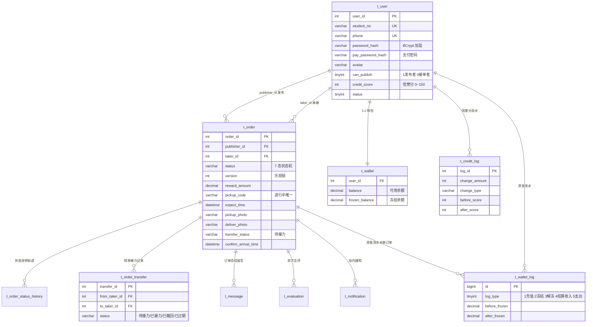

# 架构设计与技术取舍

> 校园快递代取平台 · 后端 Spring Boot 3.2 / MyBatis-Plus / MySQL 8.0，前端 Vue 3 / Vite / Element Plus
>
> 本文回答两个问题：**系统怎么分层**，以及**关键位置为什么这么设计**。后者是面试时真正能讲的部分。

---

## 1. 分层架构

```mermaid
flowchart TB
    subgraph client["客户端"]
        B["浏览器 / Vue 3 SPA"]
    end

    subgraph web["接入层"]
        NG["Nginx（生产）<br/>静态资源 + 反向代理"]
        VC["Vite Dev Server（开发）<br/>proxy /api /uploads /ws"]
        JWT["JwtInterceptor<br/>无状态令牌校验"]
        WS["WebSocket /ws<br/>未读角标实时推送"]
    end

    subgraph api["接口层 controller"]
        C1["UserController"]
        C2["OrderController"]
        C3["MessageController"]
        C4["NotificationController"]
        C5["EvaluationController"]
        C6["WalletController"]
        GEH["GlobalExceptionHandler<br/>统一 Result 结构"]
    end

    subgraph domain["领域层 service"]
        LIFECYCLE["OrderLifecycleService<br/>发布/抢单/状态机/取消/查询"]
        RELAY["OrderRelayService<br/>转单接力"]
        TIMEOUT["OrderTimeoutService<br/>超时调度（@Scheduled）"]
        OTHER["UserService / WalletService<br/>MessageService / NotificationService<br/>EvaluationService / OrderStatusHistoryService"]
        FACADE["OrderService（门面）<br/>对外契约 + 纯委派"]
    end

    subgraph data["数据访问层 mapper"]
        MP["MyBatis-Plus BaseMapper<br/>+ 自定义 XML"]
        OPT["OptimisticLockerInnerInterceptor<br/>PaginationInnerInterceptor"]
    end

    DB[("MySQL 8.0<br/>campus_express")]

    B --> NG
    B --> VC
    NG --> JWT
    VC --> JWT
    JWT --> api
    WS -.推送.-> B
    api --> FACADE
    api --> OTHER
    FACADE --> LIFECYCLE
    FACADE --> RELAY
    FACADE --> TIMEOUT
    TIMEOUT --> RELAY
    LIFECYCLE --> OTHER
    RELAY --> OTHER
    TIMEOUT --> OTHER
    LIFECYCLE --> MP
    RELAY --> MP
    TIMEOUT --> MP
    OTHER --> MP
    MP --> OPT
    OPT --> DB

    classDef n fill:#F7F7F8,stroke:rgba(23,23,23,0.12),color:#171717
    classDef f fill:#F2F7FF,stroke:#4B3FE3,color:#1A1759
    class B,NG,VC,JWT,WS,C1,C2,C3,C4,C5,C6,GEH,OTHER,MP,OPT,DB n
    class LIFECYCLE,RELAY,TIMEOUT,FACADE f
```

**请求链路**：浏览器 → Nginx/Vite 代理 → `JwtInterceptor` 鉴权 → Controller（参数接收 / 鉴权 / 组装返回）→ 领域 Service（业务规则）→ MyBatis-Plus → MySQL。

**约定**：Controller 只做参数接收、鉴权、调用 Service、组装 `Result<T>`，不写业务逻辑；业务异常统一抛 `BusinessException`，由 `GlobalExceptionHandler` 转成 `Result` 返回，前端只按 `code` 分支。

---

## 2. 订单领域拆分（原 1181 行 God Class）

`OrderServiceImpl` 原本 1181 行，混杂了订单流转、超时调度、转单接力三类关注点。现已按职责拆为三个领域服务 + 一层薄门面：

```mermaid
flowchart LR
    CTRL["OrderController"] --> FACADE["OrderServiceImpl<br/>门面 · 147 行<br/>纯委派，无业务规则"]
    FACADE --> L["OrderLifecycleServiceImpl<br/>697 行<br/>发布·修改·抢单·状态机<br/>取消·催单·照片·查询"]
    FACADE --> R["OrderRelayServiceImpl<br/>277 行<br/>接力发起·撤回·承接<br/>接力专区·接力超时撤回"]
    FACADE --> T["OrderTimeoutServiceImpl<br/>281 行<br/>无人接单提醒·超时取消<br/>超时自动确认收货"]
    T -->|"订单超时 → 使接力失效"| R
    L --> S["OrderDomainSupport<br/>共享纯函数<br/>状态历史构造·退回文案"]
    R --> S
    T --> S

    classDef n fill:#F7F7F8,stroke:rgba(23,23,23,0.12),color:#171717
    classDef f fill:#F2F7FF,stroke:#4B3FE3,color:#1A1759
    class CTRL,S n
    class FACADE,L,R,T f
```

| 类 | 行数 | 职责边界 |
| --- | --- | --- |
| `OrderServiceImpl` | 147 | 对外契约门面，仅委派 |
| `OrderLifecycleServiceImpl` | 697 | 订单生命周期与状态机（R-1 ~ R-20） |
| `OrderRelayServiceImpl` | 277 | 转单接力全流程 |
| `OrderTimeoutServiceImpl` | 281 | 定时扫描与超时自动处理 |
| `OrderDomainSupport` | 40 | 三者共用的纯函数（历史记录构造、退回通知文案） |

依赖是**单向 DAG**（超时调度 → 接力），无循环依赖。拆分对既有调用方零影响：`OrderService` 接口、`OrderController` 与前端均未改动一行。

---

## 3. 数据模型



**资金与信誉都采用「账户表 + 流水表」双写**：`t_wallet` 存当前值，`t_wallet_log` 记每次变动的 `before/after` 快照；`t_user.credit_score` 存当前分，`t_credit_log` 记每次增减。这样任何一笔余额都能倒推来源，出现争议时可审计。

---

## 4. 关键设计取舍

### 4.1 抢单为什么用乐观锁，而不是悲观锁？

**选择**：`t_order.version` + 条件更新 `WHERE order_id=? AND status='待接单' AND version=?`，影响行数为 0 即抢单失败。

**取舍**：
- 悲观锁（`SELECT ... FOR UPDATE`）要在事务里持有行锁到事务结束，抢单是**秒杀型热点写**——100 人同抢一单会形成锁队列，连接池被长时间占用，吞吐随并发数下降。
- 乐观锁是**无锁读 + 原子写**，冲突时直接失败返回业务提示，不阻塞。抢单天然是「一单一人」，冲突率高但每次冲突代价极低，与乐观锁的假设高度吻合。
- 代价是冲突时用户要重试（前端提示「手慢了」），但这在业务上是可接受的、甚至符合直觉的。

**量化验证**：`OrderTakeOrderLoadTest` 以 100 并发 × 5 轮压真实 Tomcat 端口，**全程 0 超卖**，QPS 623.22、平均延迟 138.65 ms、P95 498.35 ms。乐观锁在真实高并发下正确保证「一单一人」。

### 4.2 定时任务为什么按单独立事务（REQUIRES_NEW）？

**选择**：`timeoutRemindCancelTask` / `autoConfirmReceiptTask` 方法级**不加** `@Transactional`，改为每单用 `TransactionTemplate` 开 `REQUIRES_NEW` 独立事务，单笔异常仅记日志跳过。

**取舍**：批量事务下，只要有一单抛异常，**整批已处理的订单全部回滚**，而定时任务是 60 秒轮询——那一单会反复失败，导致整批任务**永久卡死**，后面所有订单都得不到处理。这是「一个坏数据拖垮整个系统」的典型场景。按单独立事务把故障半径限制在单条订单内。

**配套**：信誉分扣减用 SQL 层 `LEAST/`封底到 0，避免负分；扣分动作放在状态流转成功**之后**，保证不会出现「分已扣、订单却没被处理」的不可回滚状态。

### 4.3 门面为什么不再标注 `@Scheduled`？

`@Scheduled` 注解留在三个领域服务实现上。若门面也标注一遍，Spring 会把同一个方法**注册两次**，定时任务被执行两遍——超时扣分会翻倍。因此门面刻意不标注，仅在注释中写明这条约束。

### 4.4 资金结算为什么要按「订单维度净冻结额」幂等？

**问题**：订单报酬可被修改，冻结额会随之上调（追加冻结）或下调（解冻差额）。若解冻逻辑写死「解冻 = 报酬金额」，在报酬改过之后就会解冻出**与冻结额不等**的钱；而「发布者取消」与「定时任务过期自动取消」两条路径都可能触发解冻，重复解冻会导致**资金泄漏**。

**方案**：解冻前按订单维度聚合 `t_wallet_log`（冻结累计 − 解冻累计）算出**净冻结额**，仅对差额操作；同时状态变更一律带 `status='待接单'` 原状态守卫 + 检查 `updateById` 影响行数，保证同一订单只有一条路径能赢得状态流转。

**同理**：结算时按流水推算净冻结额，**仅在不足报酬时补差额**，确保冻结余额准确对齐。

### 4.5 认证为什么用 JWT 无状态令牌，而不是 Session？

- 前后端分离 + 需要横向扩展，无状态令牌免去会话粘性与共享存储（Redis）依赖，与课程技术栈（JWT 拦截器校验）一致。
- 代价是无法服务端主动失效单个令牌，因此**敏感操作二次校验**：修改/取消订单校验归属、确认收货限定发布者、上传凭证限定接单者、评价限定双方参与者、查看详情时非参与者一律脱敏（取件码与履约照片置空）——把权限判断下沉到每个接口，不依赖令牌本身携带的权限。
- 密钥通过环境变量 `JWT_SECRET` 注入：开发配置有默认值，**生产配置无默认值**，缺失则启动即失败，杜绝沿用开发密钥上线。

### 4.6 密码与支付密码：为什么都做加盐哈希 + 失败锁定？

- 登录密码与支付密码均用 BCrypt 加盐哈希存储（强度 10），相同密码两次加密结果不同，**禁止明文/可逆存储**。
- 支付密码额外做**连续错误 5 次锁定 15 分钟**，成功验证即清零计数器——支付密码位数短、熵低，必须靠限流补偿。
- 注册与改密强制**字母 + 数字**组合，正则为 `^(?=.*[A-Za-z])(?=.*\d)\S{6,20}$`。

### 4.7 上传为什么既校验扩展名又校验文件头？

仅校验扩展名可被「改名绕过」（把 `.exe` 改成 `.jpg`）。因此读取文件**魔术字节**（magic number）识别真实类型，伪装扩展名直接拒绝，并以**真实类型**作为落盘扩展名、用 UUID 重命名——不信任客户端提供的任何文件名信息。头像替换时删除旧文件，且做路径穿越防护。

### 4.8 取件码为什么按「取件码 + 取件地点」判重？为什么用「生成列 + 唯一索引」而不是普通唯一索引？

取件码本身在不同驿站可能重复（`8-2-3021` 不是全局唯一），但**同一取件地点的同一取件码**必然指向同一个包裹。因此唯一性约束是组合维度，且只约束**进行中订单**（待接单/已接单/取件中/配送中/待收货）；订单终态后释放，允许再次使用。修改订单时排除自身，避免自冲突。

**为什么不能直接加 `UNIQUE KEY (pickup_code, pickup_location)`**：业务要求「终态释放」，而普通唯一索引对历史行永远生效——某取件码只要被用过一次就再也不能复用，与「已完成/已取消后可再次使用」的规则直接冲突。

**方案**：新增虚拟生成列 `active_pickup_key`，非终态时取值、终态置 `NULL`：

```sql
active_pickup_key VARCHAR(140) GENERATED ALWAYS AS (
    IF(status IN ('已完成','已取消'), NULL, CONCAT(pickup_location, '|', pickup_code))
) VIRTUAL COMMENT '进行中订单「取件地点|取件码」唯一键，终态置 NULL 释放',
UNIQUE KEY uk_active_pickup (active_pickup_key)
```

利用 MySQL「唯一索引允许多个 `NULL`」的特性，把「终态释放」表达为 `NULL`——一条语句同时满足两个互相矛盾的要求：**进行中唯一** + **终态可复用**。生成列用 `VIRTUAL`（不占存储，`ALTER` 近似瞬时），取值由 MySQL 自动维护，应用不感知、也不写入。

**为什么不能只靠服务层 `SELECT` 判重**：判重与写入之间存在检查窗口（check-then-act），两个请求同时发布同一「取件地点 + 取件码」时都能通过判重。数据库唯一约束是并发下的**最终防线**；服务层预检保留用于「友好提示 + 避免白冻结资金」，两者分工明确——捕获 `DuplicateKeyException` 后转成同一句业务提示，用户无感。

**验证**：`OrderPickupCodeUniqueConstraintTest` 绕过服务层直接写库，断言同一组合的第二条进行中订单被 `uk_active_pickup` 拒绝、终态后同一取件码可再次写入、多条已完成订单可共存同一取件码、改码撞车同样被拒。

### 4.9 转单接力为什么「不改状态、不扣分」，且订单状态里用 `transfer_status` 单独标记？

接力是「取件前换人」——包裹还没到手，原接单者没有实际违约，因此**不改变订单状态、不扣信誉分**，仅用 `transfer_status='待接力'` 挂单，让订单同时出现在接力专区。这样：
- 订单在「我的接单」中仍归属原接单者，界面连续；
- 接力成功后只改 `taker_id`，订单状态保持「已接单/取件中」，不产生虚假的状态跳变（状态机禁止跨跳）；
- 并发承接仍走乐观锁，条件含 `transfer_status='待接力' AND taker_id=原接单者 AND version`，抢慢者得到「已被他人接力承接」。

接力权限设**双重门槛**：信誉分 ≥ 90（`business.relay.min-credit`）+ 每周最多 3 次（`business.relay.weekly-limit`，周一 00:00 重置），统计含已撤回/已过期的发起记录，防止反复挂单刷屏。

### 4.10 为什么业务参数全部外置到 `application.yml`？

信誉分阈值、等级区间、同时接单上限、各类超时小时数、报酬上下限、接力门槛、取消频控、验证码策略等全部放在 `business.*` 下，**改数值无需改代码、无需重新编译**。对应可维护性要求，也让测试可以注入不同阈值覆盖边界分支。

---

## 5. 前端结构要点

- **状态**：Pinia 管理登录态与用户信息，`studentNo` 等纳入 store 缓存避免重复请求 `/user/info`。
- **令牌持久化**：`restore()` 用 `try/catch` 包裹 `JSON.parse`，localStorage 损坏时清空并回退未登录，避免白屏。
- **路由鉴权**：未登录跳转携带 `redirect` 参数，登录成功后回跳原页面（仅允许站内路径，防开放重定向）。
- **实时推送**：`Home.vue` 建立 WebSocket 连接接收订单/通知/接力信号；组件卸载时置 `wsDisposed` 标记、清空回调再关闭，`onclose` 中判断已卸载则不再重连，**消除销毁后重连泄漏**。
- **代理一致性**：开发环境 `vite.config.js` 与生产环境 `nginx.conf` 使用同一套转发规则（`/api`、`/uploads`、`/ws`），因此前端代码无需区分环境。

---

## 6. 部署形态

```mermaid
flowchart LR
    U["浏览器"] --> FE["frontend 容器<br/>Nginx :80 → 宿主 5173"]
    FE -->|"/api /uploads /ws"| BE["backend 容器<br/>Spring Boot :8080"]
    BE --> DB[("mysql 容器<br/>MySQL 8.0 :3306 → 宿主 13306")]
    DB --- V1["volume: mysql-data"]
    BE --- V2["volume: backend-uploads"]
    BE --- V3["volume: backend-logs"]

    classDef n fill:#F7F7F8,stroke:rgba(23,23,23,0.12),color:#171717
    classDef f fill:#F2F7FF,stroke:#4B3FE3,color:#1A1759
    class U,V1,V2,V3 n
    class FE,BE,DB f
```

`docker compose up --build -d` 一键启动三件套；MySQL 首次启动自动执行 `docker/mysql-init/` 建库建表；数据卷持久化数据库、上传文件与日志。后端以 `prod` profile 运行（关闭 SQL 标准输出、验证码不回传）。

CI（GitHub Actions）三任务：`backend-test`（起 MySQL 服务 → 初始化库表 → 跑全量测试 → 上传覆盖率与压测报告）、`frontend-build`（`npm ci` + 构建）、`docker-build`（校验两个 Dockerfile 能真实构建）。

---

## 7. 已知不足与演进方向

| 项 | 现状 | 演进方向 |
| --- | --- | --- |
| 覆盖率不均 | Service 层高（Lifecycle 99.5% / Wallet 100%），Controller 与 Message/Evaluation 层偏低 | 补 Controller 层 MockMvc 用例，补齐 4 个未覆盖 Controller |
| 单库单表 | 未分库分表，索引满足当前数据量 | 订单量上来后按 `create_time` 归档历史订单 |
| 定时任务单实例 | `@Scheduled` 无分布式锁，多实例部署会重复执行 | 引入分布式调度（如 ShedLock / XXL-JOB） |
| 无短信网关 | 演示环境验证码随响应回传（`expose-code`） | 接入真实短信通道并关闭开关 |
| 无消息队列 | 通知为同步写库 + WebSocket 推送 | 高并发下改为 MQ 异步解耦 |
